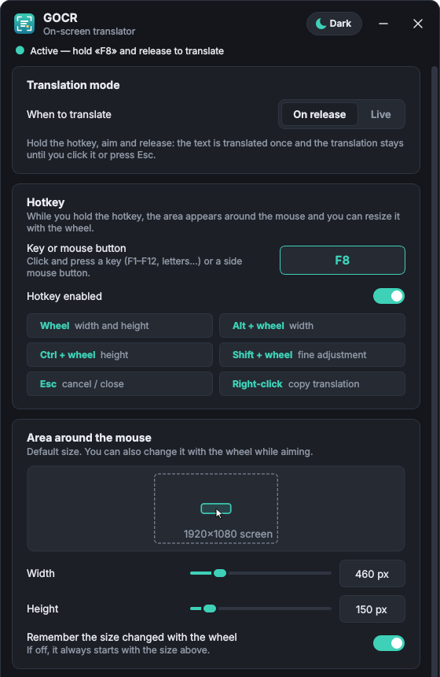
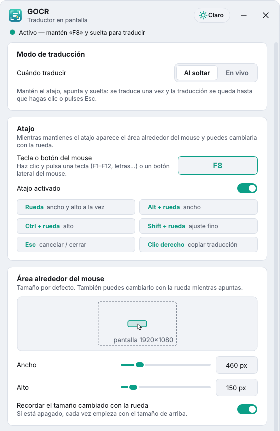

<p align="center"></p>

<h1 align="center">GOCR — on-screen translator</h1>

<p align="center">
<b>EN</b> — Hold a hotkey, aim at any text on screen (games, videos, apps) and see the translation drawn right on top of it.<br>
<b>ES</b> — Mantén un atajo, apunta a cualquier texto en pantalla (juegos, vídeos, apps) y ve la traducción dibujada encima. <a href="#español">Leer en español ↓</a>
</p>

<p align="center">

&nbsp;

</p>

GOCR lives in the **system tray** (next to the clock, like Discord or Steam). While you hold the
hotkey, a frame follows the mouse. When you release it, GOCR reads the text inside the frame with
OCR and paints the translation **over the original text**. It was made for playing games in a
language you do not fully understand, but it works on anything on your screen.

## Features

- **Two modes**
  - **On release** — hold the hotkey, aim, release: translated once; the translation stays until you click it or press Esc.
  - **Live** — like a phone camera translator: the text inside the area is translated as you move the mouse.
    Activate it by **holding** the hotkey or **tapping it on/off**.
- **Resizable area** with the mouse wheel while aiming (the wheel never reaches the game).
- **Precise selection** — only the text inside the area is translated: a small area translates a single
  word, a tall one several lines. Lines count when at least half of them is inside the frame.
- **Two OCR engines**, nothing extra to install:
  - **Windows OCR** (default) — built into Windows 10/11, very fast.
  - **RapidOCR** (PaddleOCR, bundled) — much better with decorated game fonts, glow, shadows and animated backgrounds.
    Reads the Latin alphabet (English, Spanish, French...), Cyrillic (Russian, Ukrainian...) and Chinese, detected automatically.
- **Fixes common OCR mistakes** — splits glued words (`EXITGAME` → `EXIT GAME`, `Pressanykey` → `Press any key`) and adds missing spaces after periods.
- **Free translation** through Google Translate (no account or API key), with a cache so repeated text is instant.
- Translations show up in **Win+Shift+S / Print Screen** snips.
- **Light and dark mode**, **English and Spanish** interface, start with Windows, single instance.

## Controls

| Action | What it does |
|---|---|
| **Hold the hotkey** (default `F8`) | Shows the area around the mouse |
| **Wheel** | Changes width and height together |
| **Alt + wheel** | Width only |
| **Ctrl + wheel** | Height only |
| **Shift + wheel** | Fine adjustment |
| **Release the hotkey** | Translates the text inside the area |
| **Esc** | Cancels while aiming, closes the translation or turns live mode off |
| **Click** the translation | Closes it |
| **Right-click** the translation | Copies it to the clipboard |
| Hover the translation | Shows the original text |

The hotkey can be any key or a **side mouse button**. While you hold it, the wheel and
Shift/Ctrl/Alt do not reach the game. In live mode with *tap on/off*, the wheel resizes the area
without holding the hotkey.

## Download and install

Get `GOCR-Setup.exe` (installer) or `GOCR-portable.zip` (unzip and run `GOCR.exe`) from the
**Releases** page. Nothing else is needed: no Python, no OCR install.

**Windows OCR language:** Windows OCR uses the languages installed in Windows. If your Windows is
not in English and English is missing from the list, open **PowerShell as administrator** and run:

```powershell
Add-WindowsCapability -Online -Name "Language.OCR~~~en-US~0.0.1.0"
```

…or simply switch to the RapidOCR engine.

## Build from source

Requirements: Windows 10/11 and [Python 3.10+](https://www.python.org/downloads/) (3.12 recommended,
check *Add python.exe to PATH* when installing).

```bat
build.bat      :: creates .venv, installs dependencies, builds dist\GOCR\GOCR.exe and dist\GOCR-portable.zip
run_dev.bat    :: runs GOCR straight from the source code (after build.bat ran once)
```

If [Inno Setup 6](https://jrsoftware.org/isdl.php) is installed, `build.bat` also builds
`dist\GOCR-Setup.exe`.

**GitHub Actions** builds everything on every push. Pushing a tag such as `v1.5.0` publishes a
release with the zip and the installer attached:

```bash
git tag v1.5.0
git push origin v1.5.0
```

## Project structure

```
gocr/
  app.py              controller: tray, modes, live loop, single instance
  hooks.py            global keyboard and mouse hooks (hotkey, wheel, Esc, snip keys)
  pipeline.py         capture -> OCR -> word/paragraph selection -> translation (+ cache)
  wordsplit.py        splits glued words using the wordninja word list
  translate.py        Google Translate client
  i18n.py             English / Spanish interface strings
  winapi.py           Win32 helpers (DPI, monitors, capture exclusion, startup)
  capture.py          screen capture with mss
  ocr/windows_ocr.py  Windows.Media.Ocr engine
  ocr/rapid_ocr.py    RapidOCR (PaddleOCR ONNX) engine: Latin, Cyrillic, Chinese
  ui/                 settings window, capture frame, translation overlay, theme
```

Settings and the log file are stored in `%APPDATA%\GOCR\` (`settings.json`, `gocr.log`).

## Known limitations

- Games in **exclusive fullscreen** do not allow any window on top and may capture as black.
  Use **borderless window** or **windowed** mode.
- If a game runs as administrator, GOCR must run as administrator too to receive the hotkey.
- Translation needs an internet connection.

## License

Copyright © 2026 Sairock.

GOCR is free software released under the [GNU General Public License v3.0 or later](LICENSE).
You may use, study, share and modify it, but any copy or modified version you distribute must
keep this license, credit the original author and include its source code. Bundled models and
libraries keep their own licenses — see [THIRD_PARTY_NOTICES.md](THIRD_PARTY_NOTICES.md).
Not affiliated with Google.

---

## Español

GOCR es un traductor en pantalla que vive en la **bandeja del sistema**. Mantén el atajo (por
defecto **F8**): aparece un marco alrededor del mouse. Al soltarlo, GOCR lee el texto con OCR y
pinta la traducción **encima del texto original**. Pensado para jugar en otro idioma, pero sirve
para cualquier cosa que haya en la pantalla.

- **Dos modos:** *Al soltar* (se traduce una vez) y *En vivo* (como la cámara del traductor del
  móvil: se va traduciendo mientras mueves el mouse; se activa manteniendo el atajo o tocándolo
  para encender/apagar).
- **Área ajustable con la rueda:** rueda = ancho y alto, Alt + rueda = ancho, Ctrl + rueda = alto,
  Shift + rueda = ajuste fino. Esc cancela o cierra; clic derecho copia la traducción.
- **Selección precisa:** solo se traduce lo que está dentro del área: un área pequeña traduce una
  palabra y una más alta varias líneas.
- **Dos motores OCR sin instalar nada:** Windows OCR (rápido) y RapidOCR (recomendado para letras
  decoradas de juegos; lee alfabeto latino, cirílico —ruso, ucraniano…— y chino, y lo detecta solo).
- **Corrige errores típicos del OCR:** separa palabras pegadas (`EXITGAME` → `EXIT GAME`).
- **Traducción gratis** con Google Translate, modo claro/oscuro e interfaz en **español o inglés**
  (*Ajustes › General › Idioma de la interfaz*).

**Descargar:** en la página de **Releases** está `GOCR-Setup.exe` (instalador) y
`GOCR-portable.zip` (descomprimir y abrir `GOCR.exe`). No hace falta instalar Python ni el OCR.

**Compilar:** instala Python 3.12 (marca *Add python.exe to PATH*) y ejecuta `build.bat`. Para
probar cambios sin compilar, usa `run_dev.bat`.

**Limitaciones:** en pantalla completa exclusiva no se puede dibujar encima del juego: usa
*ventana sin bordes*. Si el juego se ejecuta como administrador, GOCR también debe hacerlo.

**Licencia:** © 2026 Sairock, bajo la [GNU GPL v3.0 o posterior](LICENSE). Puedes usarlo,
estudiarlo, compartirlo y modificarlo, pero cualquier copia o versión modificada que se distribuya
debe mantener esta licencia, dar crédito al autor original e incluir su código fuente.
